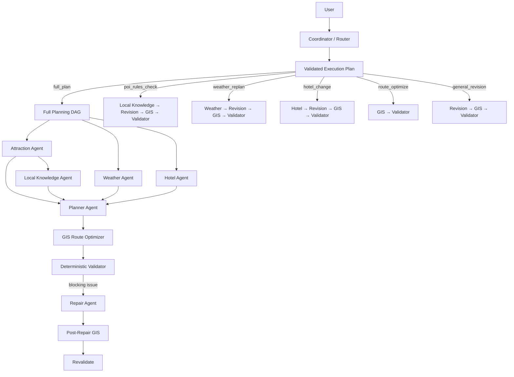

# Multi-Agent Trip Planner · AI 旅游规划助手

基于 **HelloAgents + 高德 MCP + FastAPI + Vue 3** 的多 Agent 旅游规划应用。

根据目的地、日期、预算和偏好生成每日行程，并支持天气调整、酒店替换、景点运营规则查询和路线优化。生成后检查预算、游览时长和交通时间等约束；后续修改支持差异预览，并保护已经确认的日期、酒店和景点。

**核心设计：按任务选择执行流程 · 多来源检索与引用检查 · GIS 路线优化 · 确定性校验与修改保护 · Execution Trace 与 Agent Eval**

## 使用场景

下面是交互示例，用于说明输入方式与执行流程，不代表已经发布的实测结果。

1. **生成行程**：在规划页填写城市、日期、交通方式和偏好，并补充“预算不超过 3000 元，每天最多 3 个景点，每天游览最多 6 小时”。
2. **局部修改**：已有行程后提出“第一天和酒店已经确定，不要改，把第三天改轻松一点”。
3. **确认应用**：查看候选方案与当前行程的差异，再确认应用。预览不会直接覆盖当前行程。
4. **查看执行过程**：在 Trace 中检查选中的任务图、外部来源、路线优化、校验问题和降级状态。

后续请求可以按任务独立执行：

| 请求示例 | 执行流程 |
|---|---|
| “故宫需要预约吗？如果周一闭馆就调整行程” | Local Knowledge → Revision → GIS → Validator |
| “明天下雨，把第二天改成室内” | Weather → Revision → GIS → Validator |
| “酒店换便宜一点” | Hotel → Revision → GIS → Validator |
| “这三个景点怎么排交通时间更少” | GIS → Validator |
| “第三天轻松一点” | Revision → GIS → Validator |

<!-- 后续补充真实运行的行程页面、修改差异和 Trace 截图；不使用模拟图片作为实际效果。 -->

## 核心能力

| 能力 | 说明 |
|---|---|
| 完整规划 | 景点、天气、酒店并行检索，结合景点运营规则生成结构化 TripPlan |
| 动态路由 | Coordinator 将后续任务映射到预定义执行图，减少与当前请求无关的调用 |
| 多来源检索 | 高德提供 POI、天气和酒店候选；独立 Web Search 提供运营规则候选来源 |
| 路线优化 | 对每日已选景点的访问顺序进行搜索，记录优化前后成本与数据来源 |
| 校验与修正 | 检查行程天数、预算、景点数量、游览时长、重复景点及相邻交通时间；完整规划支持一次自动修正 |
| 修改保护 | 持久化锁定日期、酒店和景点；明确日期的反馈限定本次修改范围 |
| 预览与确认 | 修改先生成预览，确认时检查会话版本，避免旧预览覆盖较新的行程 |
| 可观测与可评估 | Trace 记录路由、来源、重试、校验与降级；Eval 分别衡量路由和完整流程 |

## 快速启动

### 1. 获取项目

以下命令以本分支为例：

```bash
git clone --branch fix/amap-mcp-eval-validation https://github.com/geomini1989-cpu/helloagents-trip-planner.git
cd helloagents-trip-planner
```

建议使用与当前 CI 一致的 **Python 3.11、Node.js 20**。后端锁定 `hello-agents[protocols]==0.2.9`，以匹配当前 `SimpleAgent + MCPTool` 接口。

### 2. 启动后端

macOS / Linux：

```bash
cd backend
python -m venv venv
source venv/bin/activate
pip install -r requirements.txt
cp .env.example .env
```

Windows PowerShell：

```powershell
cd backend
python -m venv venv
.\venv\Scripts\Activate.ps1
pip install -r requirements.txt
Copy-Item .env.example .env
```

填写 `backend/.env` 后启动：

```bash
uvicorn app.api.main:app --reload --host 0.0.0.0 --port 8000
```

MCP 网关通过 `uvx amap-mcp-server` 启动。安装后端依赖后，请确认当前虚拟环境中的 `uvx` 可执行；首次启动需要联网获取 MCP Server。

### 3. 启动前端

在仓库根目录打开另一个终端：

```bash
cd frontend
npm install
```

复制环境变量示例：

```bash
# macOS / Linux
cp .env.example .env
```

```powershell
# Windows PowerShell
Copy-Item .env.example .env
```

填写 `frontend/.env` 后启动：

```bash
npm run dev
```

通过终端输出的地址访问前端。后端默认运行在 `http://localhost:8000`，前端配置默认使用该地址。

### 配置说明

| 位置 | 配置项 | 用途 |
|---|---|---|
| 后端 | `LLM_MODEL_ID` | 模型名称，示例为 `qwen-plus` |
| 后端 | `LLM_API_KEY` | 模型服务密钥 |
| 后端 | `LLM_BASE_URL` | 模型服务地址，需与模型和密钥匹配 |
| 后端 | `AMAP_API_KEY` | 高德 **Web 服务** Key，用于 MCP 检索和路线查询 |
| 后端 | `TAVILY_API_KEY` | 可选，Local Knowledge 的独立 Web Search 来源 |
| 前端 | `VITE_API_BASE_URL` | 后端地址 |
| 前端 | `VITE_AMAP_WEB_JS_KEY` | 高德 **Web 端 JS API** Key，用于地图展示 |
| 前端 | `VITE_AMAP_SECURITY_JS_CODE` | 与前端 JS API Key 配套的安全密钥 |

**后端高德 Web 服务 Key 与前端 JS API Key 类型不同，请分别配置。**

未配置 `TAVILY_API_KEY` 时，主流程仍可运行，但 Local Knowledge 会显式降级，Planner 不会获得该步骤提供的运营规则事实。可选图片服务、超时、重试和 CORS 配置见 [后端配置示例](backend/.env.example)；地图配置见 [前端配置示例](frontend/.env.example)。

## 为什么这样设计

旅行规划同时包含三类问题：

| 问题 | 示例 | 负责部分 |
|---|---|---|
| 任务选择 | 完整规划、查规则、换酒店，还是只调整路线？ | Coordinator |
| 语义规划 | 去哪些地方、如何匹配用户偏好？ | Planner / Revision 与检索 Agent |
| 确定性检查 | 是否超预算、交通是否超时、已确认内容是否被修改？ | GIS / Validator / Lock Guard |

LLM 负责理解与生成，代码负责可计算的约束和执行边界。外部检索提供候选数据，Trace 和 Eval 用于检查系统实际执行了什么。

## 系统架构

### 动态任务图

完整规划使用稳定 DAG：Attraction、Weather、Hotel 并行检索；Local Knowledge 依赖景点候选做第二阶段检索与引用检查，再汇总到 Planner。已有 Session 的后续请求由 Coordinator 选择对应执行图。



Coordinator 可以判断 intent、建议 capability，但执行图由后端白名单定义。未知 capability、任意依赖边或函数名不会被直接执行。路由模型不可用或输出无效时，系统显式使用确定性启发式路由降级。

每个请求创建独立 Agent 上下文，避免消息历史跨用户、Session 或 Eval case 混用。

### 多来源检索与引用检查

不同数据由不同来源提供：

| 来源 | 主要用途 |
|---|---|
| AMap MCP | POI、地址、经纬度、天气和酒店候选 |
| AMap REST | 带超时与缓存的路线成本查询 |
| Tavily Web Search | 开放时间、预约、闭馆、票务和临时公告的候选来源 |

Local Knowledge 基于检索来源输出结构化 claim。模型标记为 `verified` 的声明，只有在 `source_url` 与本轮实际检索返回的 URL 完全匹配时，才能保留该状态。

| 状态 | 下游处理 |
|---|---|
| `verified` | 作为运营规则上下文传给 Planner / Revision |
| `unverified` | 仅作为提醒 |
| `unsupported` | 引用了本轮未返回的来源，保留到 Trace / Eval，并从事实上下文中过滤 |

**URL 匹配验证的是引用来源，不等同于声明内容正确、来源权威或信息仍然有效。** 内容正确性、时效性及冲突来源处理仍需进一步评估。

缺少 Web Search Key 或 claim JSON 无效时，该步骤显式降级。

### GIS 与校验修正

Planner 决定景点集合，GIS 优化每日访问顺序。对常见的每日 2–3 个景点，系统枚举候选顺序，基于有向成本矩阵选择交通成本更低的方案，并记录优化前后成本。

路线优先使用高德数据；不可用时使用 Haversine 坐标估算，并记录 fallback 来源。

Validator 检查行程天数、总预算、每日景点数量、游览时长、重复景点、相邻交通时间和路线来源。完整规划发现 blocking issue 时触发一次最小范围 Repair，再执行 GIS 与校验。仍未解决时，结果标记为 `degraded`。

公共交通行程中，短距离公交路线超过单段上限时，Validator 会尝试查询真实步行路线；只有步行路线也满足上限时才通过，并记录 `walking_alternative_segments`。明确要求仅公交或仅地铁时不采用该替代方案。

### 修改保护与会话持久化

修改保护包含三层：

- **持久化锁定**：日期、全部酒店和指定景点的锁定状态保存在 Session；Lock Guard 恢复被模型或 GIS 改动的锁定内容，并记录 violation。
- **修改范围保护**：明确提出“修改第二天”时，将本次目标限制为第二天；其他日期的意外改动会被恢复。全局反馈不会自动限定日期。
- **预览确认**：候选方案有效期为一小时；确认应用时检查 Session 版本，旧预览与当前状态冲突时拒绝覆盖。

SQLite 保存原始 `TripRequest`、当前计划、历史、Trace、锁定状态与版本。后续任务可以恢复原始交通方式、预算、强度和路线约束。

### Execution Trace

Trace 展示 Coordinator intent、路由来源、选中能力与任务图，以及实际执行节点。还记录检索来源、claim 状态、latency、retry、错误类别、GIS 优化前后结果、校验问题、锁定违规和降级状态。

Session 时间线保留历史；Pipeline 展示最近一次 Coordinator 任务，便于区分首次规划与后续修改。

## 评估与验证

### 三层验证

| 层级 | 验证对象 | 外部配置 |
|---|---|---|
| Offline CI | Python 编译、pytest 单元测试、Vue / TypeScript 构建 | 无需真实服务密钥 |
| Coordinator Routing Eval | 意图识别与预定义能力图选择 | LLM 配置 |
| Full Live Agent Eval | 真实检索、规划、GIS、校验与修正 | LLM、高德、Tavily 配置 |

现有离线 CI 工作流针对 `main` 的 push 和目标为 `main` 的 PR 运行。Live Eval 缺少对应密钥时显式跳过该层，不将 mock 或空跑当作真实结果。

### 关键指标

| 评估对象 | 指标 |
|---|---|
| 路由正确性 | `intent_accuracy`、`capability_exact_match_rate`、`minimal_graph_rate` |
| 路由冗余与遗漏 | `unnecessary_agent_call_rate`、`missing_capability_rate` |
| 检索与输出 | `retrieval_agent_success_rate`、`structured_output_success_rate` |
| Local Knowledge 引用 | `local_knowledge_source_coverage_rate`、`local_knowledge_unsupported_claim_rate` |
| 约束与修正 | `validation_pass_rate`、`repair_success_rate` |
| 可靠性与延迟 | `fallback_rate`、`agent_step_retry_rate`、`average_latency_ms`、`p95_latency_ms` |

Full Eval 同时检查日期和明确指定景点，并保存逐日景点名称、坐标与 POI ID，便于复查失败案例。POI ID 覆盖率仅反映标识是否存在，不代表运营规则已核实。

### 运行评估

从仓库根目录进入后端，并使用已配置的虚拟环境：

```bash
cd backend

# 仅评估 Coordinator
python -m evals.run_routing_eval

# 完整行程评估
python -m evals.run_eval

# 先运行前三个完整案例
python -m evals.run_eval --limit 3
```

评估基础设施已经实现；当前 [Roadmap](docs/ROADMAP.md) 将真实路由与完整流程基线列为下一步重点。README 不预填成绩，发布结果时应附运行日期、模型配置、代码版本、案例数量和报告链接。

指标定义、测试范围与报告说明见 [Evaluation & Testing](docs/EVALUATION.md)。

## API

| 接口 | 用途 |
|---|---|
| `POST /api/trip/plan` | 完整规划 |
| `POST /api/trip/dispatch` | 统一任务入口：新请求完整规划，已有 Session 动态路由 |
| `POST /api/trip/revise` | 兼容修改入口，内部使用 Coordinator 动态路由 |
| `POST /api/trip/preview` | 执行修改并保存候选预览 |
| `POST /api/trip/preview/{preview_id}/apply` | 检查版本后应用预览 |

`/dispatch` 没有 `session_id` 时需提供 `trip_request`；有 `session_id` 时基于已有计划选择任务图。

## 技术栈与目录

| 部分 | 技术 |
|---|---|
| Agent / 后端 | Python、HelloAgents / SimpleAgent、MCPTool、FastAPI、Pydantic |
| 检索与路线 | 高德 MCP、高德 REST、Tavily、Haversine、小规模排列搜索 |
| 会话与并行 | SQLite、ThreadPoolExecutor |
| 前端 | Vue 3、TypeScript、Vue Router、Vite、Ant Design Vue、高德 JS API |
| 测试与评估 | pytest、Routing Eval、Full Agent Eval、GitHub Actions |

```text
helloagents-trip-planner/
├── backend/
│   ├── app/
│   │   ├── agents/       # 检索、规划与修改 Agent
│   │   ├── api/routes/   # 规划、任务路由、预览与确认
│   │   ├── models/       # 请求、行程、约束与执行数据
│   │   └── services/     # 编排、GIS、校验、锁定与持久化
│   ├── evals/            # 完整流程和路由评估
│   └── tests/
├── frontend/
│   └── src/views/        # Home、Result、Trace
├── docs/                 # 架构、Local Knowledge、评估、路线图
└── .github/workflows/    # 离线 CI 与真实服务评估
```

## 当前边界与下一步

- **路线优化范围**：优化每日已选景点的访问顺序；尚未覆盖完整开放时间窗口、酒店起终点和复杂多模式约束。
- **数据可信度**：坐标 fallback 不能作为实测交通时间；来源 URL 匹配不能证明运营规则正确且最新。
- **修正次数**：完整规划最多进行一次 Repair，未解决的问题保留在结果与 Trace 中。
- **部署范围**：当前使用 SQLite，多实例部署需要共享持久化方案。
- **UI 设计**：当前使用 Typed TripPlan 与确定性 Vue 渲染。动态部分是任务图和业务数据，暂未引入 A2UI。

下一步优先完成可复现的真实评估基线、失败案例分析，以及带来源和 Trace 的演示截图。详细计划见 [Roadmap](docs/ROADMAP.md)。

## 详细文档

- [Architecture](docs/ARCHITECTURE.md) — Agent 分工、动态执行图、GIS、Validator、Repair 与设计取舍
- [Local Knowledge Agent](docs/LOCAL_KNOWLEDGE.md) — Web 来源、结构化声明、引用检查与降级策略
- [Evaluation & Testing](docs/EVALUATION.md) — 路由与完整流程评估、指标定义与结果使用
- [Roadmap](docs/ROADMAP.md) — 完成状态、当前边界与后续优先级
