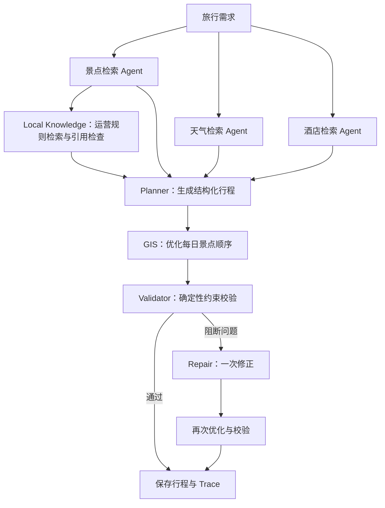

# Multi-Agent Trip Planner · 多 Agent 旅行规划助手

基于 **HelloAgents、FastAPI 和 Vue 3** 的旅行规划项目：从目的地、日期和偏好生成结构化行程，再通过自然语言持续调整。高德 MCP 提供景点、天气和酒店候选，独立网页检索补充运营规则，代码负责路线优化、约束校验和会话保存。

项目围绕一个实际问题展开：**行程生成以后，如何在预算、路线和已确认内容的约束下继续修改，并让每一步都有据可查？**

> 本文对应 `fix/review-validation-and-state` 分支的实现，代码基线为 `26e4f76`。默认 `main` 分支与该分支内容不同，运行时请使用下方指定分支。

[快速启动](#快速启动) · [Agent 工作流程](#agent-工作流程) · [修改与状态管理](#修改与状态管理) · [测试与评估](#测试与评估) · [接口说明](#接口说明)

## 能做什么

- **生成每日行程**：结合景点、天气、住宿和偏好，输出包含景点、餐饮、酒店、预算与地图信息的行程。
- **按需求修改**：支持雨天重排、酒店替换、景点规则查询、路线调整和一般行程修改；Coordinator 为请求选择对应流程。
- **保护已确认内容**：锁定日期、酒店或指定景点；明确要求只改某一天时，保护其他日期。
- **先预览再应用**：展示修改差异，确认后保存；过期或版本冲突的预览不能覆盖新行程。
- **保存手动编辑**：编辑结果经过服务端校验后入库，后续 AI 修改使用更新后的行程。
- **查看执行过程**：Trace 展示路由、调用、来源、重试、校验和降级；行程页面支持图片和 PDF 导出。

### 一个典型使用过程

1. 选择城市、日期、交通方式和住宿偏好，补充：“预算不超过 3000 元，每天最多 3 个景点，每天游览最多 6 小时。”
2. 生成后查看每日安排、地图、预算和执行轨迹。
3. 提出：“第一天和酒店已经确定，不要改，把第三天改轻松一点。”
4. 查看修改预览，确认后应用。也可以手动编辑并保存，再继续提出新的要求。

以上是输入与操作示例，并非真实旅行效果或评估成绩。

## Agent 工作流程

系统将语义理解、外部信息获取和确定性计算分开：Agent 理解需求并生成候选方案，后端限定可执行流程，GIS 和 Validator 检查可计算的约束。

### 首次规划

景点、天气和酒店并行检索；Local Knowledge 根据景点候选补充开放、预约等运营规则。Planner 汇总信息生成行程，随后进行路线优化与校验。发现阻断问题时，最多进行一次 Repair，再次优化和校验。



首次规划修正后仍有问题时，执行轨迹会记录 `degraded`，结果可能仍然返回。应结合校验报告判断行程是否可用。

### 已有行程的后续请求

Coordinator 识别意图，后端将其映射到预定义的能力图：

| 请求示例 | 执行流程 |
|---|---|
| “明天下雨，把第二天改成室内” | Weather → Revision → GIS → Validator |
| “酒店换便宜一点” | Hotel → Revision → GIS → Validator |
| “故宫需要预约吗？闭馆的话帮我调整” | Local Knowledge → Revision → GIS → Validator |
| “调整这些景点的游览顺序，减少交通时间” | GIS → Validator |
| “第三天轻松一点” | Revision → GIS → Validator |

模型只能选择已定义的意图，不能直接指定 Python 函数、创建能力或任意执行边。路由输出无效或模型不可用时，会使用启发式规则，并在 Trace 中记录降级。Agent 上下文按请求创建，避免不同会话共用对话历史。

### 数据来源与职责

| 组件 | 负责内容 |
|---|---|
| 高德 MCP | POI、地址、坐标、天气与酒店候选 |
| Tavily Web Search | 开放时间、预约、闭馆、票务和公告的候选来源 |
| Planner / Revision | 根据需求和检索上下文生成、调整行程 |
| 高德 REST + GIS | 查询路线成本，优化每日已选景点的访问顺序 |
| Validator / Repair | 检查约束；首次规划中尝试一次修正 |
| SQLite + Trace | 保存行程、有效请求、版本、历史、锁定状态与执行记录 |

Local Knowledge 对模型声明的来源做检查：只有 `source_url` 与本轮实际检索返回的 URL 匹配，才能保留 `verified` 状态；无支持来源的声明会从事实上下文中过滤。**引用匹配只说明来源在本轮检索中出现，不保证内容正确、权威或仍然有效。**

GIS 优先使用高德路线数据；不可用时使用坐标距离估算，并记录 fallback 来源。优化范围是每日已选景点的访问顺序，不包含完整的开放时间窗口、酒店起终点或复杂多模式交通约束。

## 修改与状态管理

### 保存前检查约束

Validator 检查行程天数、预算、每日景点数量、游览时长、重复景点和相邻交通时间。预算总额必须等于非负费用分项之和，不能通过低报总额绕过预算上限。

已有行程的 `revise`、带 Session 的 `dispatch` 和 `preview` 共用保存门槛：修改失败、缺失校验结果或存在阻断问题时返回 `422`，不覆盖当前行程。

用户后续提出的可识别量化约束也会进入校验。例如把预算从 3000 元改为 1000 元，候选方案按新上限检查；使用预览流程时，新约束随确认应用一同保存。

### 锁定与修改范围

- **持久化锁定**：支持锁定日期、全部酒店和指定景点，后续修改持续生效。
- **范围保护**：明确要求修改某一天时，恢复其他日期的意外变化。
- **费用同步**：恢复锁定内容或手动调整景点等明细时，按费用变化修正已有预算分项。

日期锁定按分句及日期关系解析，例如“第一天改成公园，第二天不要改”不会把第一天一并锁定。自然语言约束解析覆盖常见明确表达；更精确的控制可使用 API 的结构化约束与锁定字段。

### 预览、手动编辑与版本冲突

预览保存候选方案及其基准版本，有效期为一小时。应用时检查当前 Session 版本；行程已经发生变化时返回 `409`，需要重新生成预览。

手动编辑通过服务端接口保存，携带 `expected_version`。后端校验版本、城市与日期、锁定内容和行程约束，成功后递增版本。页面加载时重新读取服务端行程，后续 AI 修改基于已保存的内容执行。

会话默认保存在 `backend/data/trip_planner.db`。如需更换位置，在启动进程前设置环境变量 `TRIP_DATA_DIR`。保留该目录可在服务重启后恢复会话。

## 快速启动

### 1. 获取对应分支

```bash
git clone --branch fix/review-validation-and-state https://github.com/geomini1989-cpu/helloagents-trip-planner.git
cd helloagents-trip-planner
```

环境建议与仓库 CI 保持一致：**Python 3.11、Node.js 20**。后端依赖固定为 `hello-agents[protocols]==0.2.9`，使用对应版本的 `SimpleAgent + MCPTool` 接口。

### 2. 安装后端依赖

Windows PowerShell：

```powershell
cd backend
python -m venv venv
.\venv\Scripts\Activate.ps1
python -m pip install -r requirements.txt
Copy-Item .env.example .env
```

macOS / Linux：

```bash
cd backend
python -m venv venv
source venv/bin/activate
python -m pip install -r requirements.txt
cp .env.example .env
```

填写 `backend/.env`：

```dotenv
LLM_MODEL_ID=qwen-plus
LLM_API_KEY=替换为模型服务密钥
LLM_BASE_URL=https://dashscope.aliyuncs.com/compatible-mode/v1
AMAP_API_KEY=替换为高德Web服务Key

# 可选：启用景点运营规则的独立网页检索
TAVILY_API_KEY=替换为Tavily密钥
```

模型名、服务地址和密钥需要对应同一服务配置。不使用 Tavily 时，将示例中的占位值清空；缺少该配置时 Local Knowledge 显式降级。

在后端目录、虚拟环境已激活的终端运行：

```bash
uvx --version
uvicorn app.api.main:app --reload --host 127.0.0.1 --port 8000
```

MCP 客户端会启动 `uvx amap-mcp-server` 子进程，首次运行需要联网获取服务依赖。若找不到 `uvx`，检查虚拟环境是否激活、后端依赖中的 `uv` 是否安装完成。

### 3. 启动前端

从仓库根目录另开终端：

```bash
cd frontend
npm ci
```

复制 `frontend/.env.example` 为 `frontend/.env`，填写：

```dotenv
VITE_API_BASE_URL=http://localhost:8000
VITE_AMAP_WEB_JS_KEY=替换为高德Web端JS_API_Key
VITE_AMAP_SECURITY_JS_CODE=替换为配套安全密钥
```

```bash
npm run dev
```

使用终端显示的前端地址访问应用。默认开发端口为 `5173`；后端交互式接口文档位于 [http://localhost:8000/docs](http://localhost:8000/docs)。

**后端高德 Web 服务 Key 与前端 Web 端 JS API Key 是不同类型，需要分别申请和配置。** 如果前端端口变化，也需要同步调整后端 `CORS_ORIGINS`。

超时、重试、可选图片服务和其他配置见 [后端环境变量示例](backend/.env.example) 与 [前端环境变量示例](frontend/.env.example)。

## 测试与评估

离线测试验证代码行为，真实服务评估验证模型、检索与完整流程表现，两者分别运行。

### 离线检查

后端，在已激活的虚拟环境中执行：

```bash
cd backend
python -m pip install -r requirements-dev.txt
python -m compileall app evals
python -m pytest tests -q
```

前端：

```bash
cd frontend
npm ci
npm run build
```

测试覆盖路由、检索降级、GIS、预算校验、锁定保护、会话持久化、预览与版本冲突。其中 [修复回归测试](backend/tests/test_review_regressions.py) 覆盖候选方案拒绝保存、后续约束生效、手动编辑保存和旧版本冲突等场景。

当前离线 CI 仅对 `main` 的 push 和目标为 `main` 的 PR 自动运行，其他分支需自行执行上述检查。

### 真实 Agent 评估

在后端目录、配置好对应服务密钥后运行：

```bash
# 仅评估 Coordinator 的意图识别与能力图选择
python -m evals.run_routing_eval

# 先运行三个完整规划案例
python -m evals.run_eval --limit 3

# 运行完整案例集
python -m evals.run_eval
```

路由评估只依赖模型配置；完整流程评估还涉及高德与 Tavily 等外部服务。默认报告分别写入 `backend/evals/reports/routing-latest.json` 和 `backend/evals/reports/latest.json`。

| 评估维度 | 指标示例 |
|---|---|
| 路由与调用范围 | 意图准确率、能力图精确匹配率、最小图比例、多余或遗漏调用率 |
| 检索与输出 | 检索成功率、结构化输出成功率 |
| 引用与来源 | Local Knowledge 来源覆盖率、无支持声明比例 |
| 约束与可靠性 | 校验通过率、修正成功率、重试率、降级率 |
| 性能 | 平均延迟、P95 延迟 |

当前 README 不声明真实服务评估成绩。发布结果时，应一并给出代码版本、模型配置、运行日期、案例数量与报告，不能把规则降级或 mock 测试当作模型效果。指标定义见 [评估与测试文档](docs/EVALUATION.md)。

## 接口说明

| 方法与路径 | 用途 |
|---|---|
| `POST /api/trip/plan` | 生成完整行程并创建 Session |
| `POST /api/trip/dispatch` | 统一任务入口：首次规划或已有行程的动态路由 |
| `POST /api/trip/revise` | 修改已有行程，通过校验后直接保存 |
| `POST /api/trip/preview` | 生成并保存候选预览，不直接替换当前行程 |
| `POST /api/trip/preview/{preview_id}/apply` | 检查版本后应用预览 |
| `GET /api/trip/session/{session_id}` | 读取当前行程、有效请求、历史、版本和锁定状态 |
| `PUT /api/trip/session/{session_id}/plan` | 保存手动编辑，提交 `expected_version` 与 `data` |
| `PUT /api/trip/session/{session_id}/locks` | 设置日期、酒店和景点锁定 |
| `GET /api/trip/trace/{session_id}` | 读取执行轨迹 |

`dispatch` 无 `session_id` 时需提供 `trip_request`，有 `session_id` 时基于现有行程执行。请求与响应字段以运行中的 `/docs` 为准。

## 技术栈与代码导航

| 层级 | 技术 |
|---|---|
| Agent 与后端 | Python、HelloAgents、SimpleAgent、MCPTool、FastAPI、Pydantic |
| 数据与计算 | 高德 MCP / REST、Tavily、路线排列搜索、坐标距离估算 |
| 状态与并行 | SQLite、ThreadPoolExecutor |
| 前端 | Vue 3、TypeScript、Vite、Ant Design Vue、高德 JS API |
| 测试与评估 | pytest、Routing Eval、Full Agent Eval、GitHub Actions |

```text
helloagents-trip-planner/
├── backend/
│   ├── app/
│   │   ├── agents/       # 检索、规划、修改与修正 Agent
│   │   ├── api/routes/   # 规划、预览、编辑、会话与 Trace 接口
│   │   ├── models/       # 行程、请求、约束与锁定模型
│   │   └── services/     # 路由、编排、GIS、预算、校验与持久化
│   ├── evals/            # 路由与完整流程评估
│   └── tests/            # 单元测试与回归测试
├── frontend/src/         # 规划输入、结果编辑、地图与 Trace 页面
├── docs/                 # 设计、评估与路线图
└── .github/workflows/    # 离线检查与真实服务评估
```

## 当前边界

- 自然语言约束依赖已实现的解析规则，不能保证理解任意复杂表述；预算和交通结果仍受输入数据与外部服务影响。
- 首次规划最多修正一次，仍存在阻断问题时可能返回降级结果；已有行程的修改则要求通过校验后才能保存。
- 路线 fallback 是坐标估算，来源 URL 匹配也不等于对运营规则完成事实核验。
- SQLite 适合当前本地演示形态；多实例部署需要重新考虑共享存储和状态管理。
- 前端使用结构化 TripPlan 与 Vue 组件渲染，当前未引入 A2UI。

后续工作包括可复现的真实评估基线、失败案例分析，以及带来源和 Trace 的演示。更多设计与计划：

- [系统架构](docs/ARCHITECTURE.md)
- [Local Knowledge 设计](docs/LOCAL_KNOWLEDGE.md)
- [评估与测试](docs/EVALUATION.md)
- [开发路线图](docs/ROADMAP.md)
