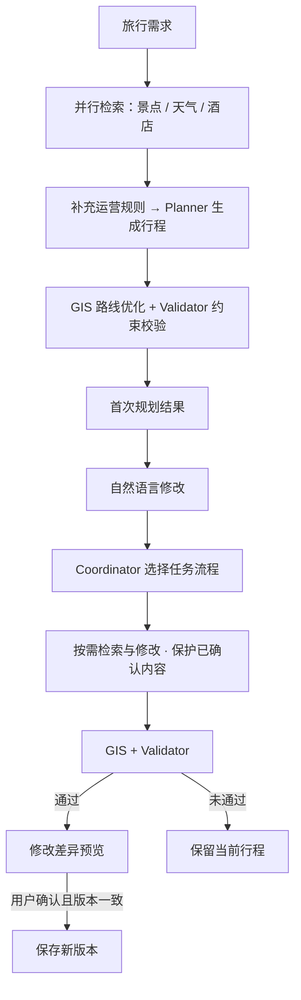

<div align="center">

# Multi-Agent Trip Planner
### 多 Agent 旅行规划助手

**从生成行程到反复调整，让旅行计划逐步变成你想要的样子。**

输入目的地、日期和偏好，生成包含景点、住宿、天气与预算的每日行程。<br>
计划确定后，继续用自然语言调整安排，预览修改差异，并保留已经确认的内容。

**HelloAgents · 高德 MCP · FastAPI · Vue 3**

[使用场景](#使用场景) · [快速开始](#快速开始) · [工作原理](#工作原理) · [测试与评估](#测试与评估) · [开发文档](#开发文档)

</div>

---

## 核心功能

| | 你可以做什么 |
|---|---|
| **多 Agent 协作规划** | 结合景点、天气、住宿与运营规则，生成每日安排，并查看地图和预算 |
| **用自然语言持续调整** | 根据天气换活动、替换酒店、调整游览顺序，或让某一天轻松一些 |
| **看清修改再确认** | 先查看候选方案与当前行程的差异，保护已确认的日期、酒店和景点，再应用修改 |
| **查看每一步执行过程** | 在 Trace 中查看选择了哪些 Agent、使用了哪些来源，以及校验、重试和降级情况 |

行程页面同时支持手动编辑、服务端保存，以及图片和 PDF 导出。

## 使用场景

### 一次规划，多轮完善

下面是交互流程示例，展示输入方式与操作步骤，并非实测行程或运行截图。

**① 提出需求**

> 北京玩 3 天，预算不超过 3000 元，每天最多 3 个景点，喜欢历史文化，主要乘坐公共交通。

在规划页填写城市、日期等信息，并补充偏好与约束。生成后查看每日行程、酒店、天气、地图与预算。

**② 保留确定的内容，调整有变化的部分**

> 第一天和酒店已经确定，不要改。第二天下雨，帮我换成室内活动。

系统根据请求选择天气相关流程，生成候选修改，并保护锁定内容。

**③ 查看差异，再决定是否应用**

查看候选行程与原计划的差异，确认后保存。后续也可以手动编辑并保存，再继续让 AI 调整。

**④ 查看执行依据**

打开 Trace，检查本次调用的 Agent、来源和校验报告；遇到降级结果时，可以追查具体步骤。

### 还可以这样提问

| 你的需求 | 请求示例 |
|---|---|
| 减轻游览强度 | “把第三天改轻松一点，每天游览最多 4 小时。” |
| 调整住宿 | “酒店换便宜一点。” |
| 核查运营规则 | “故宫需要预约吗？如果闭馆就调整行程。” |
| 优化游览顺序 | “这些景点怎么安排，交通时间更少？” |
| 收紧预算 | “预算改成不超过 2000 元。” |

## 快速开始

建议使用 **Python 3.11、Node.js 20**。准备模型服务密钥与高德 Key；若需要检索景点开放、预约等规则，再配置 Tavily。

> 当前功能位于 `fix/review-validation-and-state` 分支；默认 `main` 与该分支内容不同。

### 1. 获取项目

```bash
git clone --branch fix/review-validation-and-state https://github.com/geomini1989-cpu/helloagents-trip-planner.git
cd helloagents-trip-planner
```

### 2. 启动后端

<details open>
<summary><b>Windows PowerShell</b></summary>

```powershell
cd backend
python -m venv venv
.\venv\Scripts\Activate.ps1
python -m pip install -r requirements.txt
Copy-Item .env.example .env
```

</details>

<details>
<summary><b>macOS / Linux</b></summary>

```bash
cd backend
python -m venv venv
source venv/bin/activate
python -m pip install -r requirements.txt
cp .env.example .env
```

</details>

编辑 `backend/.env`，填写以下配置：

| 配置项 | 说明 |
|---|---|
| `LLM_MODEL_ID` | 模型名称，示例配置使用 `qwen-plus` |
| `LLM_API_KEY` | 对应模型服务的密钥 |
| `LLM_BASE_URL` | 与模型、密钥匹配的服务地址 |
| `AMAP_API_KEY` | 高德 **Web 服务** Key |
| `TAVILY_API_KEY` | 可选；不使用时清空占位值，运营规则检索会显式降级 |

在后端目录、虚拟环境已激活的终端启动服务：

```bash
uvicorn app.api.main:app --reload --host 127.0.0.1 --port 8000
```

### 3. 启动前端

从仓库根目录另开终端：

```bash
cd frontend
npm ci
```

复制 `frontend/.env.example` 为 `frontend/.env`，填写：

```dotenv
VITE_API_BASE_URL=http://localhost:8000
VITE_AMAP_WEB_JS_KEY=替换为高德Web端JS_API_Key
VITE_AMAP_SECURITY_JS_CODE=替换为配套安全密钥
```

```bash
npm run dev
```

打开终端显示的前端地址，填写一次旅行需求开始规划。默认前端端口为 `5173`，后端 API 文档位于 [localhost:8000/docs](http://localhost:8000/docs)。

<details>
<summary><b>配置说明与启动排查</b></summary>

- **高德 Key 类型**：后端使用 Web 服务 Key，前端使用 Web 端 JS API Key 及配套安全密钥，需要分别配置。
- **MCP 服务**：后端通过 `uvx amap-mcp-server` 启动子进程，首次运行需要联网获取依赖。找不到 `uvx` 时，检查虚拟环境是否激活，以及依赖中的 `uv` 是否安装。
- **框架版本**：后端固定使用 `hello-agents[protocols]==0.2.9`，对应当前的 `SimpleAgent + MCPTool` 接口。
- **前端端口变化**：同步更新后端 `CORS_ORIGINS`。
- **会话存储**：默认写入 `backend/data/trip_planner.db`；可在启动进程前设置 `TRIP_DATA_DIR` 更换位置。

完整配置见 [后端环境变量示例](backend/.env.example) 与 [前端环境变量示例](frontend/.env.example)。

</details>

## 工作原理

首次规划并行获取景点、天气和酒店候选，再补充运营规则，由 Planner 生成结构化行程。已有行程的修改则由 Coordinator 选择对应流程，按需调用相关能力。



*图示为页面的规划与预览流程。首次规划发现阻断问题时最多修正一次；仍有问题时可能返回降级结果。*

以“第二天下雨，改成室内”为例，后续执行链为 **Weather → Revision → GIS → Validator**；仅调整路线顺序时则为 **GIS → Validator**。这些流程由后端白名单定义，模型负责意图判断。

| 机制 | 解决的问题 | 在哪里查看 |
|---|---|---|
| 按任务选择 Agent | 为不同修改请求调用对应能力 | Trace 中的路由结果与实际执行节点 |
| 确定性约束校验 | 检查预算、游览强度、重复景点和交通时间 | 校验报告与阻断原因 |
| 锁定与范围保护 | 保留已确认内容，限制明确指定日期的修改范围 | 候选行程对比与保护记录 |
| 预览及版本检查 | 防止旧候选覆盖已经更新的计划 | 修改预览、确认结果与冲突提示 |

高德 MCP 提供景点、天气和酒店候选，高德 REST 提供路线成本，Tavily 提供运营规则候选来源；SQLite 保存会话、历史版本与执行轨迹。

<details>
<summary><b>修改保存与一致性细节</b></summary>

### 保存前检查约束

Validator 检查行程天数、预算、每日景点数量、游览时长、重复景点和相邻交通时间。预算总额必须等于非负费用分项之和，不能通过低报总额绕过预算上限。

已有行程的 `revise`、带 Session 的 `dispatch` 和 `preview` 共用保存门槛：修改失败、缺失校验结果或存在阻断问题时返回 `422`，不覆盖当前行程。

用户后续提出的可识别量化约束也会进入校验。例如把预算从 3000 元改为 1000 元，候选方案按新上限检查；使用预览流程时，新约束随确认应用一同保存。

### 锁定与修改范围

- **持久化锁定**：支持锁定日期、全部酒店和指定景点，后续修改持续生效。
- **范围保护**：明确要求修改某一天时，恢复其他日期的意外变化。
- **费用同步**：恢复锁定内容或手动调整景点等明细时，按费用变化修正已有预算分项。

日期锁定按分句及日期关系解析，例如“第一天改成公园，第二天不要改”不会把第一天一并锁定。自然语言约束解析覆盖常见明确表达；更精确的控制可使用 API 的结构化约束与锁定字段。

### 预览、手动编辑与版本冲突

预览保存候选方案及其基准版本，有效期为一小时。应用时检查当前 Session 版本；行程已经发生变化时返回 `409`，需要重新生成预览。

手动编辑通过服务端接口保存，携带 `expected_version`。后端校验版本、城市与日期、锁定内容和行程约束，成功后递增版本。页面加载时重新读取服务端行程，后续 AI 修改基于已保存的内容执行。

会话默认保存在 `backend/data/trip_planner.db`。如需更换位置，在启动进程前设置环境变量 `TRIP_DATA_DIR`。保留该目录可在服务重启后恢复会话。

</details>

## 测试与评估

项目分别提供离线测试、Coordinator 路由评估和真实完整流程评估。

| 验证层级 | 关注内容 |
|---|---|
| 离线测试与构建 | 路由规则、校验、锁定、会话保存、预览冲突与前端类型检查 |
| 路由评估 | 意图准确率、能力图匹配、多余或遗漏的调用 |
| 完整流程评估 | 检索与结构化输出、来源覆盖、校验与修正、降级率及延迟 |

[回归测试](backend/tests/test_review_regressions.py) 覆盖超预算候选拒绝保存、新预算约束生效、手动编辑持久化与旧版本冲突等行为。

<details>
<summary><b>运行测试与评估</b></summary>

后端：在仓库根目录、已激活虚拟环境的终端执行。

```bash
cd backend
python -m pip install -r requirements-dev.txt
python -m compileall app evals
python -m pytest tests -q
```

前端：从仓库根目录另开终端执行。

```bash
cd frontend
npm ci
npm run build
```

真实评估：配置好对应服务密钥，在后端目录执行。

```bash
# 仅评估 Coordinator 路由
python -m evals.run_routing_eval

# 先运行三个完整规划案例
python -m evals.run_eval --limit 3
```

默认报告写入 `backend/evals/reports/routing-latest.json` 与 `backend/evals/reports/latest.json`。路由评估依赖模型配置；完整流程还涉及高德、Tavily 等外部服务。

当前离线 CI 仅对 `main` 的 push 和目标为 `main` 的 PR 自动运行。

</details>

真实服务的效果基线尚待补充。评估结果应附代码版本、模型配置、运行日期和案例数量；离线测试不代表真实旅行规划效果。详细指标见 [评估与测试](docs/EVALUATION.md)。

## 当前限制

- **首次规划可能降级返回**：最多进行一次自动修正，使用前需查看校验报告；已有行程的修改必须通过校验才能保存。
- **数据存在边界**：路线不可用时使用坐标估算；运营规则的引用匹配不保证内容正确或最新。
- **优化与解析范围有限**：当前优化每日已选景点顺序，尚未覆盖完整开放时间窗口与酒店起终点；自然语言约束覆盖常见明确表达。
- **部署以本地演示为主**：会话使用 SQLite，多实例部署需要额外设计。

## 开发文档

| 文档 | 内容 |
|---|---|
| [系统架构](docs/ARCHITECTURE.md) | Agent 分工、任务路由、GIS、Validator 与 Repair |
| [Local Knowledge](docs/LOCAL_KNOWLEDGE.md) | 运营规则检索、引用检查与降级处理 |
| [评估与测试](docs/EVALUATION.md) | 评估案例、指标定义与报告说明 |
| [开发路线图](docs/ROADMAP.md) | 当前进度与后续计划 |

<details>
<summary><b>API 速查</b></summary>

| 方法与路径 | 用途 |
|---|---|
| `POST /api/trip/plan` | 生成完整行程并创建 Session |
| `POST /api/trip/dispatch` | 统一任务入口：首次规划或已有行程的动态路由 |
| `POST /api/trip/revise` | 修改已有行程，通过校验后直接保存 |
| `POST /api/trip/preview` | 生成并保存候选预览，不直接替换当前行程 |
| `POST /api/trip/preview/{preview_id}/apply` | 检查版本后应用预览 |
| `GET /api/trip/session/{session_id}` | 读取当前行程、有效请求、历史、版本和锁定状态 |
| `PUT /api/trip/session/{session_id}/plan` | 保存手动编辑，提交 `expected_version` 与 `data` |
| `PUT /api/trip/session/{session_id}/locks` | 设置日期、酒店和景点锁定 |
| `GET /api/trip/trace/{session_id}` | 读取执行轨迹 |

`dispatch` 无 `session_id` 时需提供 `trip_request`，有 `session_id` 时基于现有行程执行。请求与响应字段以运行中的 `/docs` 为准。

</details>

后续优先补充真实行程演示、可复现的评估基线与失败案例分析。
